Tashkent, Uzbekistan &nbsp;·&nbsp; Computer Science student at Webster University

## Experience

### Smart Aurum / DaisyAI
**Backend Engineer / Team Lead** · 2026 – Present

AI-powered personal productivity and life-balance platform.

- Promoted to Backend Team Lead: leading backend development and coordinating engineering tasks.
- Designing the backend architecture and defining the technical MVP scope.
- Building REST APIs with Django and Django REST Framework.
- Implementing asynchronous processing with Celery and Redis.
- Working on integrations with external health and calendar platforms.
- Taking part in architecture and technical decisions and release planning, alongside a Flutter developer on the product.

`Python` `Django 5` `Django REST Framework` `PostgreSQL` `Redis` `Celery` `AWS` `Firebase`

### Techna
**Python Backend Engineer** · 2026 – Present

Backend services, AI-powered business automation and conversational commerce.

- Developed an AI-powered sales assistant integrated with the Bito platform.
- Implemented product catalog synchronization: descriptions, characteristics, prices, stock and photos.
- Built conversational AI flows in Uzbek and Russian.
- Implemented product recommendations, upselling, order creation and order status tracking.
- Developed web chat backend functionality: session management, message history, cursor pagination and idempotency.
- Worked with RAG architecture, vector search, LLM integrations and tool calling.

`Python` `FastAPI` `SQLAlchemy` `PostgreSQL` `pgvector` `Redis` `Celery` `Haystack` `Vertex AI Gemini`

## Toolkit

**Languages** &nbsp; `Python` `SQL` 
**Backend** &nbsp; `Django` `Django REST Framework` `FastAPI` `SQLAlchemy` 
**Databases** &nbsp; `PostgreSQL` `Redis` `pgvector` 
**AI engineering** &nbsp; `RAG` `LLM integrations` `AI agents` `Tool calling` `Embeddings` `Vector search` 
**Infrastructure** &nbsp; `Docker` `Linux` `Nginx` `AWS` `Cloudflare` 
**Other** &nbsp; `REST APIs` `WebSockets` `OAuth2` `Webhooks` `Celery` `Git`

## Contact

[LinkedIn](https://www.linkedin.com/in/javohir-nurmatjonov) &nbsp;·&nbsp; [Telegram](https://t.me/javoxirone) &nbsp;·&nbsp; [javoxirone@gmail.com](mailto:javoxirone@gmail.com)
