  

  <a href="https://nurmatjonov.uz">nurmatjonov.uz</a> &nbsp;·&nbsp;
  <a href="https://www.linkedin.com/in/javohir-nurmatjonov">LinkedIn</a> &nbsp;·&nbsp;
  <a href="https://t.me/javoxirone">Telegram</a> &nbsp;·&nbsp;
  <a href="mailto:javoxirone@gmail.com">javoxirone@gmail.com</a>

 

<b>PRODUCT</b> AI-powered personal productivity and life-balance platform.

<b>WORK</b>

<ul>
  <li>Promoted to <b>Backend Team Lead</b>: leading backend development and coordinating engineering tasks.</li>
  <li>Designing the backend architecture and defining the technical MVP scope.</li>
  <li>Building REST APIs with Django and Django REST Framework.</li>
  <li>Implementing asynchronous processing with Celery and Redis.</li>
  <li>Working on integrations with external health and calendar platforms.</li>
  <li>Taking part in architecture and technical decisions and release planning, alongside a Flutter developer on the product.</li>
</ul>

<b>STACK</b> <code>Python</code> <code>Django 5</code> <code>Django REST Framework</code> <code>PostgreSQL</code> <code>Redis</code> <code>Celery</code> <code>AWS</code> <code>Firebase</code>

<b>PRODUCT</b> Backend services, AI-powered business automation and conversational commerce.

<b>WORK</b>

<ul>
  <li>Developed an AI-powered sales assistant integrated with the Bito platform.</li>
  <li>Implemented product catalog synchronization: descriptions, characteristics, prices, stock and photos.</li>
  <li>Built conversational AI flows in Uzbek and Russian.</li>
  <li>Implemented product recommendations, upselling, order creation and order status tracking.</li>
  <li>Developed web chat backend functionality: session management, message history, cursor pagination and idempotency.</li>
  <li>Worked with RAG architecture, vector search, LLM integrations and tool calling.</li>
</ul>

<b>STACK</b> <code>Python</code> <code>FastAPI</code> <code>SQLAlchemy</code> <code>PostgreSQL</code> <code>pgvector</code> <code>Redis</code> <code>Celery</code> <code>Haystack</code> <code>Vertex AI Gemini</code>

 

<b>LANGUAGES</b> <code>Python</code> <code>SQL</code>

<b>BACKEND</b> <code>Django</code> <code>Django REST Framework</code> <code>FastAPI</code> <code>SQLAlchemy</code>

<b>DATABASES</b> <code>PostgreSQL</code> <code>Redis</code> <code>pgvector</code>

<b>AI ENGINEERING</b> <code>RAG</code> <code>LLM integrations</code> <code>AI agents</code> <code>Tool calling</code> <code>Embeddings</code> <code>Vector search</code>

<b>INFRASTRUCTURE</b> <code>Docker</code> <code>Linux</code> <code>Nginx</code> <code>AWS</code> <code>Cloudflare</code>

<b>OTHER</b> <code>REST APIs</code> <code>WebSockets</code> <code>OAuth2</code> <code>Webhooks</code> <code>Celery</code> <code>Git</code>

 

Public repositories and public contributions only, refreshed daily by <a href="https://github.com/javoxirone/javoxirone/blob/main/.github/workflows/profile-stats.yml">a workflow in this repository</a>. Private work is not counted.

 

  
  
  
  

